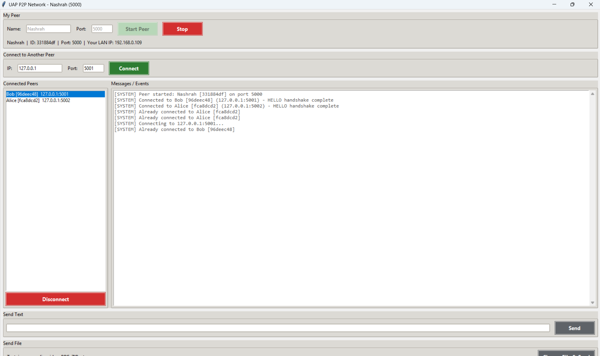
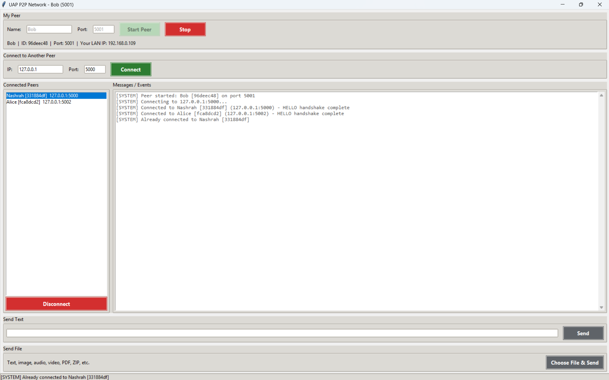
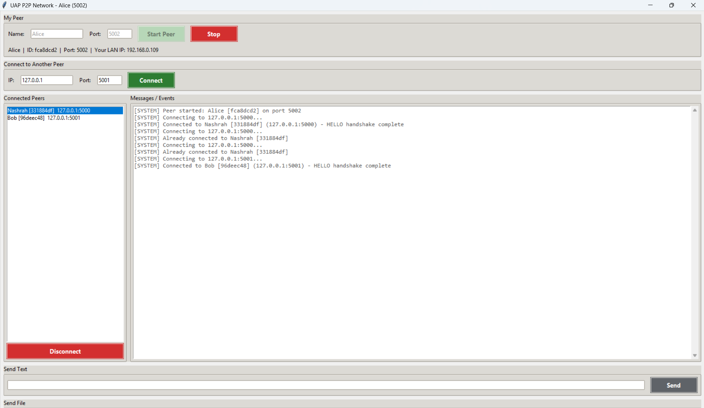
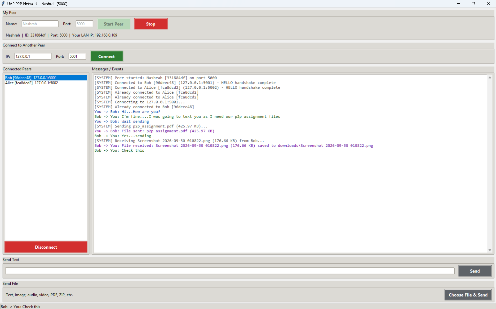
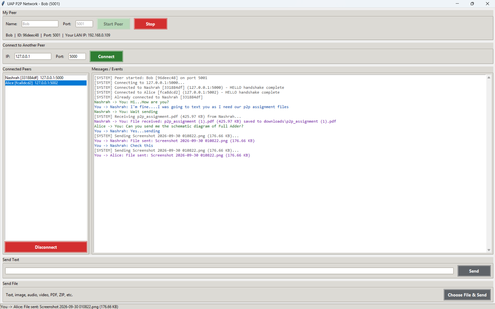
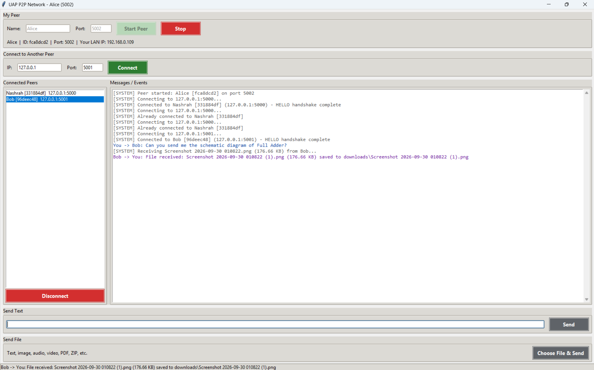

# P2P Network - Communication and File Sharing

CSE 433 – Blockchain & Distributed Security Lab  
University of Asia Pacific

## Project Overview

This project implements a lightweight peer-to-peer (P2P) communication system in Python. Each running instance acts as a peer that can both receive incoming connections and initiate outgoing connections to other peers. Unlike a client-server model, there is no central server involved. Every peer is responsible for discovering, connecting, and exchanging messages directly with other peers in the network.

The system allows peers to:
- discover and connect to other peers using IP address and port,
- exchange text messages,
- transfer files of any type,
- maintain a real-time peer list,
- manage multiple simultaneous connections using threads.

## Problem Statement

Traditional centralized messaging and file-sharing systems depend on a central server, which creates a single point of failure and reduces scalability. A P2P architecture distributes the communication load across peers, making the system more resilient, decentralized, and suitable for lightweight local and LAN-based communication.

This project demonstrates the core principles of decentralized communication, socket programming, and direct data exchange without a controlling server.

## Objectives

- Build a decentralized peer-to-peer network using Python sockets.
- Enable peer-to-peer text communication.
- Support direct file transfer between connected peers.
- Implement reliable message framing and data transfer protocol.
- Maintain a simple GUI-based interface for easy usage.
- Demonstrate practical networking concepts in a blockchain/distributed security context.

## Key Features

- Unique peer ID generation for each peer instance
- Peer discovery with name, ID, IP, and port information
- HELLO / HELLO_ACK handshake for connection identification
- Text messaging between selected peers
- File transfer for any file type
- Chunk-based binary transfer using 64 KB segments
- Multiple simultaneous peer connections with thread-based handling
- Automatic file saving in the `downloads/` directory
- Graceful error handling for invalid IP, port, disconnection, timeouts, and missing files

## System Architecture

The application consists of the following major components:

- `main.py` – Tkinter-based graphical user interface
- `p2p_node.py` – peer logic, TCP server/client implementation, messaging, and file transfer
- `protocol.py` – framing and JSON protocol handling
- `downloads/` – folder where incoming files are stored
- `requirements.txt` – dependency file (no third-party libraries required)

### Communication Model

Each peer runs:
- a TCP server to accept incoming connections,
- a TCP client to connect to other peers,
- socket threads to handle multiple connection requests concurrently.

Messages are exchanged using a custom length-prefixed protocol to ensure correct message boundaries and reliable parsing.

## Project Structure

```text
P2P_Network/
├── main.py               # GUI application
├── p2p_node.py           # Peer networking and socket logic
├── protocol.py           # Message format and protocol framing
├── requirements.txt      # Project requirements
├── README.md             # Project documentation
├── downloads/            # Stored incoming files
├── screenshots/          # Optional screenshots for demo
└── __pycache__/          # Python cache files
```

## Technologies Used

- Python 3.9+
- Tkinter (for GUI)
- Socket programming
- Threading
- JSON-based message protocol
- Binary file transfer with chunked reads/writes

## Requirements

- Python 3.9 or later
- Windows, Linux, or macOS
- Tkinter support for your OS
- No external packages are required

### Linux Note

If Tkinter is not installed, run:

```bash
sudo apt install python3-tk
```

## Installation and Setup

1. Install Python 3.9+ from the official Python website.
2. Ensure Python is added to `PATH` during installation.
3. Download or extract the project folder.
4. Open a terminal in the project directory.
5. Run the application:

```bash
python main.py
```

## How to Run the Application

1. Launch `main.py`.
2. Enter a peer name and port number.
3. Click **Start Peer**.
4. The application starts listening for incoming peer connections.
5. Use the interface to connect to other peers and begin communication.

Example log output:

```text
[SYSTEM] Peer started: Alice [a83f21c4] on port 5000
```

## How to Connect Peers

### On the Same Computer

1. Open terminal 1 and run the program with name `Alice` and port `5000`
2. Open terminal 2 and run the program with name `Bob` and port `5001`
3. In Bob's GUI, enter `127.0.0.1` and port `5000`
4. Click **Connect**
5. Both peers will appear in each other's connected peer list

### On Different Computers in the Same Network

1. Start a peer on each computer
2. Note the local LAN IP address from each machine
3. Enter the other machine's IP and port in the connect field
4. Click **Connect**

If connection fails, allow Python through the firewall when prompted.

## Sending Messages and Files

### Text Messaging

- Select a connected peer
- Type a message in the input box
- Click **Send** or press Enter

### File Transfer

- Select a connected peer
- Click **Choose File & Send**
- Select any file from the system
- The receiver saves the file in the `downloads/` folder

Received files are stored with unique names if a file with the same name already exists, such as:

```text
photo (1).jpg
```

## Protocol Design

Each control message is represented in JSON and sent using a length-prefixed message framing format:

```text
[4-byte length][JSON payload]
```

### Supported Message Types

| Type | Fields |
|------|--------|
| `hello` | `peer_id`, `peer_name`, `port` |
| `hello_ack` | `peer_id`, `peer_name`, `port` |
| `text` | `sender_id`, `sender_name`, `message` |
| `file` | `sender_id`, `sender_name`, `filename`, `filesize` |

### Handshake Process

- The connecting peer sends a `hello` message.
- The target peer replies with `hello_ack`.
- Both peers mark each other as connected.

### File Transfer Process

- The sender sends a `file` metadata message
- The sender then sends the raw file data in 64 KB chunks
- The receiver reads until the total file size is complete
- The file is then saved on the receiving end

## Demo and Screenshots

### 1. Starting Peers and HELLO Handshake

The screenshots below show the three peers starting and connecting to one another. When peers connect, they exchange `hello` and `hello_ack` messages to complete the handshake.

#### Peer 1



#### Peer 2



#### Peer 3



### 2. Messaging and File Transfer

These screenshots show text messaging between peers and the file transfer process.

#### Peer 1 - Messaging and file transfer



#### Peer 2 - Messaging and file transfer



#### Peer 3 - Messaging and file transfer



## Limitations

- The project is intended for local network or LAN communication
- It does not include advanced peer discovery protocols
- There is no encryption or authentication layer
- The system is designed as a lightweight academic demonstration rather than a production-grade app

## Future Improvements

- Add end-to-end encryption for secure communication
- Implement peer discovery using a tracker or distributed protocol
- Add chat history and message persistence
- Support file resume and partial download recovery
- Add user authentication and peer trust management

## Conclusion

This project demonstrates the basic concepts of decentralized communication using Python sockets and peer-to-peer networking. It combines networking, threading, protocol design, and GUI development into a practical distributed application that reflects the principles behind modern blockchain and distributed systems.

## Authors

- CSE 433 – Blockchain & Distributed Security Lab
- University of Asia Pacific

## License

This project is intended for academic and educational use.
